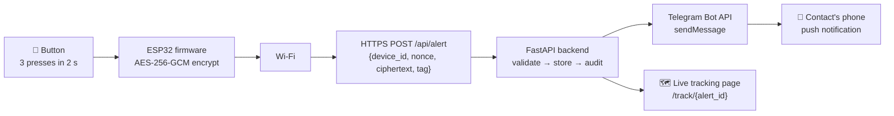
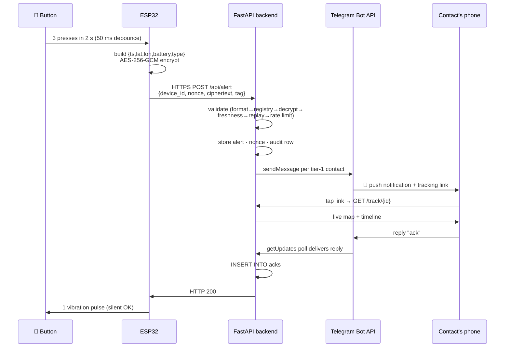
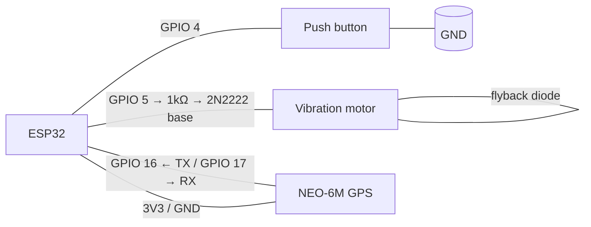

# SilentSOS
 

> ⚡ **Run it in 60 seconds** (details in [How to run SilentSOS](#how-to-run-silentsos)):
> ```bash
> git clone <https://github.com/sakshyam-hola/SilentSOS.git> silentsos && cd silentsos
> python -m venv .venv && source .venv/bin/activate   # Windows: .venv\Scripts\Activate.ps1
> pip install -r requirements.txt
> cp .env.example .env && cp simulator/config.example.json simulator/config.json
> python scripts/seed_demo.py          # SAVE the printed key → paste it as "key" in simulator/config.json
> uvicorn backend.main:app --port 8001 # then open http://127.0.0.1:8001/simulator and triple-click SOS
> ```

> **Last verified:** 2026-10-16 — every technical claim below was checked
> against the code in this repo (field names, endpoints, environment
> variables, file paths, pin numbers). Where the old README and the code
> disagreed, the code won. The "Run it in 60 seconds" commands were
> additionally executed end-to-end on a clean machine on 2026-10-17.
> Anything I could **not** verify from the code is
> listed at the bottom under [Things not (yet) in the code](#things-not-yet-in-the-code).

**One-paragraph pitch.** SilentSOS is a discreet emergency-alert system for
situations where pulling out a phone is slow, visible, or dangerous —
harassment, assault, a medical crisis. The device is a pocket-sized ESP32
board with a single button: **three quick presses silently sends an
AES-256-GCM encrypted distress signal** with live GPS location to a backend,
which verifies it and notifies the owner's trusted contacts over Telegram
with a live tracking link. No screen, no sound, no visible action — and a
single vibration pulse confirms the alert got through.

## Table of contents

1. [Features](#features)
2. [Architecture](#architecture)
3. [Project structure](#project-structure)
4. [How to run SilentSOS](#how-to-run-silentsos)
5. [How a button press reaches a trusted contact's phone](#how-a-button-press-reaches-a-trusted-contacts-phone)
6. [Quick start (software only, no hardware)](#quick-start-software-only-no-hardware)
7. [Telegram bot setup](#telegram-bot-setup)
8. [ESP32 setup (when the hardware arrives)](#esp32-setup-when-the-hardware-arrives)
9. [Security design](#security-design)
10. [Deployment](#deployment)
11. [Demo guide](#demo-guide)
12. [Testing](#testing)
13. [FAQ](#faq)
14. [License and credits](#license-and-credits)
15. [Things not (yet) in the code](#things-not-yet-in-the-code)

## Features

| Feature | Status |
|---|---|
| Encrypted alert protocol (AES-256-GCM, replay + freshness + rate-limit protection) | **Working now** |
| FastAPI backend: alert intake, validation, audit log, tracking API | **Working now** |
| Telegram notifications to trusted contacts (alert / escalated / safe) | **Working now** |
| Contact replies `ack` via Telegram, shown live on the tracking page | **Working now** |
| Automatic escalation to tier-2 contacts if nobody acks in time | **Working now** |
| Live tracking page (`/track/{id}`) with map, timeline, stat cards | **Working now** |
| Operator dashboard (`/`) with KPIs, charts, device list | **Working now** |
| Security center (`/security`): live audit feed, attack simulator | **Working now** |
| Incident report (`/report/{id}`): printable/PDF report for resolved alerts | **Working now** |
| Web + CLI device simulators (speak the exact encrypted protocol) | **Working now** |
| Safe Walk timer with duress PIN (web simulator) | **Working now** |
| PWA: installable, offline tracking page, English/नेपाली, high-contrast mode | **Working now** |
| ESP32 firmware (button, vibration, GPS, NTP, TLS) | **Simulated until hardware arrives** — written and Wokwi-testable, never run on a physical board here |
| Real GPS coordinates from a NEO-6M module | **Simulated until hardware arrives** (`USE_GPS 0` sends fixed demo coordinates) |
| SMS fallback via SIM800L for low-connectivity areas | **Roadmap** |
| Signal / push notifications as an alternative to Telegram | **Roadmap** |
| Battery optimization (real battery sensing, deep sleep) | **Roadmap** — firmware currently sends a fixed demo battery value |

## Architecture



The device never talks to Telegram directly. It only talks to the backend
over HTTPS; the backend fans out to Telegram and serves the tracking page.

## Project structure

```text
silentsos/
├── backend/                # FastAPI server (the whole backend)
│   ├── main.py             #  endpoints, validation chain, escalation + purge sweepers
│   ├── crypto.py           #  AES-256-GCM encrypt/decrypt helpers
│   ├── registry.py         #  SQLite schema, seed/show/export-config CLI
│   ├── telegram.py         #  Bot API calls, getUpdates polling, /start linking, ack handling
│   ├── demo.py             #  in-process attack demos for the security center
│   └── static/             #  web pages served by the backend
│       ├── home.html       #  operator dashboard (/)
│       ├── track.html      #  live incident tracking (/track/{id})
│       ├── report.html     #  printable incident report (/report/{id})
│       ├── security.html   #  security center (/security)
│       ├── i18n.js         #  English + Nepali UI strings (separate file)
│       └── sw.js           #  service worker (PWA offline support)
├── simulator/              # software stand-ins for the ESP32
│   ├── device_sim.py       #  CLI simulator: speaks the real encrypted protocol
│   ├── web.html            #  web simulator page (/simulator) incl. Safe Walk
│   └── config.example.json #  copy to config.json, fill in the device key
├── firmware/silentsos/     # ESP32 Arduino sketch (real hardware, when it arrives)
│   ├── silentsos.ino       #  button/GPS/crypto/HTTPS logic
│   ├── config.example.h    #  copy to config.h (git-ignored), fill in secrets
│   └── diagram.json        #  Wokwi simulator wiring
├── scripts/                # helpers: seed_demo.py, attack_demo.py
├── backend/tests/          # automated test suite (pytest)
├── docs/                   # PROTOCOL.md (frozen spec), DEPLOY.md, THREAT_MODEL.md,
│                           #  PITCH.md, DEMO_CHECKLIST.md, JUDGE_QA.md, HARDWARE_SWAP.md
├── Dockerfile              # production container (used by Render)
├── requirements.txt        # Python dependencies
└── .env.example            # copy to .env (never commit the real one)
```

---

## How to run SilentSOS

> **Note:** this section overlaps with [Quick start](#quick-start-software-only-no-hardware)
> below — Quick start is the short path; this is the complete reference with
> every command, every variable, and every failure mode.

### 1. Prerequisites

| Tool | Minimum version | How to check | Where to get it |
|---|---|---|---|
| **Python** (the language this project uses) | 3.10+ (3.12 is what the Dockerfile uses) | `python --version` | [python.org](https://www.python.org/downloads/) |
| **Git** | any recent version | `git --version` | [git-scm.com](https://git-scm.com/downloads) |
| **pip** | ships with Python | `pip --version` | — |
| **Docker** *(optional, step 12 only)* | 20+ | `docker --version` | [docker.com](https://www.docker.com/products/docker-desktop/) |
| A modern browser (Chrome/Edge/Firefox) | any recent version | — | — |

*Expected result:* `python --version` prints something like `Python 3.12.3`.

*If it fails:* on Windows, `python` may not be found even after installing —
re-run the installer and tick **"Add python.exe to PATH"**, or use `py`
instead of `python` in every command below.

### 2. Get the code

```bash
git clone <your-repo-url> silentsos
cd silentsos
```

*Expected result:* a `silentsos/` folder containing `backend/`, `simulator/`,
`firmware/`, `requirements.txt`, and the rest of the project tree above.

*If it fails:* `git: command not found` — install Git from the table above
and restart your terminal.

### 3. Install dependencies

Create and activate a virtual environment first (keeps this project's
packages separate from your system Python):

```bash
python -m venv .venv
```

```bash
# Windows (PowerShell):
.venv\Scripts\Activate.ps1
# macOS / Linux:
source .venv/bin/activate
```

Then install from the real requirements file:

```bash
pip install -r requirements.txt
```

*Expected result:* pip installs `fastapi`, `uvicorn`, `cryptography`, and
`requests` with no errors. Your prompt shows `(.venv)` (or `(.venv)` on
Windows).

*If it fails:* `pip: command not found` — the venv isn't activated; repeat
the activate step. On Windows, if activation is blocked by the execution
policy, run `Set-ExecutionPolicy -Scope Process -ExecutionPolicy Bypass`
first.

### 4. Configure environment variables

```bash
# Windows (PowerShell):
Copy-Item .env.example .env
# macOS / Linux:
cp .env.example .env
```

Every variable (all from `.env.example`):

| Name | Purpose | Example value | Required? |
|---|---|---|---|
| `SILENT_DB_PATH` | Where the SQLite database lives | `./data/silentsos.db` | No — defaults to `./data/silentsos.db` |
| `PORT` | Port the server listens on | `8001` | No — the run command sets it |
| `PUBLIC_BASE_URL` | Base URL put into Telegram tracking links | `http://127.0.0.1:8001` | No — defaults to `http://127.0.0.1:8001`; set to your public `https://` URL when deployed |
| `TELEGRAM_BOT_TOKEN` | Telegram bot token for notifications | *(empty)* | No — **alerts work fine without it**; only Telegram messages stop arriving |
| `ESCALATION_SECONDS` | Seconds with no ack before tier-2 contacts are notified | `60` | No — defaults to `60` |
| `SILENT_DEVICE_ID` / `SILENT_DEVICE_KEY` | Shown commented-out in `.env.example` | — | No — the simulator reads `simulator/config.json`, not these variables |

**For a software-only demo you can leave everything as-is** (all empty or
defaults). The one thing that stops working with an empty
`TELEGRAM_BOT_TOKEN` is Telegram delivery: no alert/safe messages, no
`ack` by reply — but the web **Ack** button on the tracking page
(`POST /api/alerts/{id}/ack`) still works, and so does everything else.

> **Warning:** `.env` is git-ignored. Never commit it, never paste tokens
> or keys from it into a chat.

### 5. Seed the demo data

```bash
python scripts/seed_demo.py
```

*Expected result:*

```text
Seeded demo device 'dev-001' with 3 demo contacts (2x tier 1, 1x tier 2).

!!! SAVE THIS KEY NOW — it is shown only once !!!
SILENT_DEVICE_KEY=<44-character base64 key>

Set it in your environment (PowerShell):
  $env:SILENT_DEVICE_ID="dev-001"
  $env:SILENT_DEVICE_KEY="<44-character base64 key>"
Never commit this key to source control.
```

The key is **shown only in this terminal output** and stored in the
database. Copy it now — the CLI simulator needs it in the next step, and
re-running the seeder will *not* print it again. It must never be
committed to git.

*If it fails:* `ModuleNotFoundError` — the venv isn't activated (step 3).
If it says `dev-001 already seeded`, the database already exists; that's
fine, but you won't get the key back — delete `data/silentsos.db` and run
again if you lost it.

Now point the simulator at the key:

```bash
# Windows (PowerShell):
Copy-Item simulator\config.example.json simulator\config.json
# macOS / Linux:
cp simulator/config.example.json simulator/config.json
```

Open `simulator/config.json` and paste the key as the `"key"` value
(keeping the quotes). `simulator/config.json` is git-ignored.

### 6. Start the server

```bash
uvicorn backend.main:app --port 8001
```

*Expected result:*

```text
INFO:     Uvicorn running on http://127.0.0.1:8001
```

Open **http://127.0.0.1:8001** in your browser — the operator dashboard
loads.

*If it fails:* `Address already in use` — something is already on port
8001; stop it or use `--port 8002` (and change `base_url` in
`simulator/config.json` to match).

**Health check** — in another terminal (or the browser):

```bash
curl http://127.0.0.1:8001/api/health
```

*Expected result:*

```json
{"status":"ok","time":1792131206,"db":"ok"}
```

(`time` is the server's Unix clock; `db` is `ok` when SQLite is
reachable.) *If it fails:* `curl: (7) Failed to connect` — the server
isn't running; go back to the start command.

### 7. Run the demo

**a. Open the home page** — http://127.0.0.1:8001 — the operator dashboard
with KPI cards, device list, and recent alerts.

**b. Open the web simulator** — http://127.0.0.1:8001/simulator — and
**triple-click the SOS button within 2 seconds**. The status log shows the
alert being accepted.

**c. Or use the CLI simulator** (new terminal, venv activated):

```bash
python simulator/device_sim.py
```

Press **Enter three times quickly** (within 2 s). Two extra commands:

```text
hold      simulate a 3-second long press -> sends type "safe"
route     send "update" every 3 s along a preset route (Ctrl+C stops)
quit      exit
```

*Expected result:* `vibration: 1 short pulse` (HTTP 200 accepted).
*If it fails:* `vibration: 3 short pulses` — the server isn't reachable;
check step 6.

**d. Open the tracking link** — the simulator prints the alert id, or
click **View** on the home page. Watch the live map, the ACTIVE badge with
its ticking timer, and the stat cards.

**e. Click "I'm safe / resolve"** — the badge flips to RESOLVED and the
timer freezes.

**f. Open /security** — http://127.0.0.1:8001/security — the audit log
shows every request with its verdict badge; click any row for the
validation checklist.

**g. One-click scenario** — back on the home page, click **▶ Run demo
scenario**. It plays a ~35 s scripted story on its own (alert → location
updates → a simulated contact acks → resolve) with a step indicator and a
"watch it live" link to the tracking page.

### 8. Run the attack demo

With the server running, in another terminal (venv activated):

```bash
python scripts/attack_demo.py
```

*Expected result* — a PASS/FAIL table (exit code 0 when all pass):

```text
Attack                Expected    Got               Result
────────────────────────────────────────────────────────────
Replay                409         409               PASS
Tampered ciphertext   401         401               PASS
Expired timestamp     408         408               PASS
Wrong key             401         401               PASS
Unknown device        401         401               PASS
Flood (20 in 10s)     >=10x 429   4x 200, 16x 429   PASS
────────────────────────────────────────────────────────────
6/6 passed
```

What each attack proves: **Replay** — a captured packet can't be resent
(nonce already used → `409`); **Tampered ciphertext** — modified bytes fail
GCM tag verification (`401`); **Expired timestamp** — a 5-minute-old
message fails the ±60 s freshness window (`408`); **Wrong key** —
decryption with the wrong key fails (`401`); **Unknown device** — unregistered
devices are rejected (`401`); **Flood** — the 5/min rate limit kicks in
(`429`s). The flood test sends 20 requests and runs last because it
exhausts the rate-limit window.

*If it fails:* `config.json` errors mean step 5's key paste wasn't done.
Connection errors mean the server isn't running (step 6).

### 9. Run the automated tests

```bash
pip install pytest httpx
python -m pytest backend/tests/ -q
```

> **Note:** `pytest` and `httpx` are test-only dependencies, intentionally
> **not** in `requirements.txt`.

*Expected result:*

```text
96 passed
```

*If it fails:* run from the repo root (not from `backend/`), with the venv
activated. A single failing test name tells you which area broke — e.g.
`test_escalation.py` failures point at the tier/timeout logic.

### 10. Run with Telegram enabled

Short checklist (full walkthrough in [Telegram bot setup](#telegram-bot-setup)):

- [ ] Create a bot with @BotFather (`/newbot`, username must end in `bot`)
- [ ] Put the token in `.env` as `TELEGRAM_BOT_TOKEN`
- [ ] **Restart the server** (the token is read at startup) and confirm
      the log says `telegram polling started`
- [ ] Link a contact: `python backend/telegram.py --codes`, then the
      contact sends `/start <CODE>` to the bot
- [ ] Send a test alert and confirm the 🚨 message + tracking link arrive

### 11. Run with the real ESP32 later

Short checklist (full walkthrough in [ESP32 setup](#esp32-setup-when-the-hardware-arrives)):

- [ ] **Deploy the backend publicly first** — the ESP32 cannot reach
      `localhost`; use the public `https://` URL as `SERVER_URL`
- [ ] Provision a fresh device row (don't reuse the demo key) and fill in
      `firmware/silentsos/config.h` (git-ignored)
- [ ] Flash, open Serial Monitor at 115200 baud, confirm Wi-Fi + NTP sync
- [ ] Triple-press → alert → Telegram → tracking page, same as the demo above

The simulator and the real device speak the **same encrypted protocol**
(`docs/PROTOCOL.md`) and hit the same `/api/alert` endpoint, so everything
you verified with the simulator applies to the hardware.

### 12. Run with Docker

Only if you have Docker — a `Dockerfile` exists in the repo root.

```bash
docker build -t silentsos .
```

```bash
docker run -p 8001:8001 --env-file .env silentsos
```

*Expected result:* the container seeds the demo device on first start
(watch `docker logs` for the printed key — save it), then serves on
http://127.0.0.1:8001.

Notes: the image listens on `0.0.0.0:${PORT:-8001}`; `--env-file .env`
passes all your variables (including `TELEGRAM_BOT_TOKEN` and
`PUBLIC_BASE_URL`) into the container. For a public URL, add
`-e PUBLIC_BASE_URL=https://<your-host>` (or put it in `.env`).

*If it fails:* `docker: command not found` — install Docker Desktop. Port
conflicts behave like step 6 — remap with `-p 8002:8001` and set `PORT=8001`
inside (or just change the host side).

### 13. Common problems

| Symptom | Cause | Fix |
|---|---|---|
| `Address already in use` on start | Something already on port 8001 | Stop it, or run with `--port 8002` (and update `simulator/config.json` → `base_url`) |
| `ModuleNotFoundError: No module named 'fastapi'` | Venv not activated | Activate it (step 3); prompt should show `(.venv)` |
| `no such table: devices` / empty pages | Seed never ran | `python scripts/seed_demo.py` (step 5) |
| `'key' is not valid base64` in the simulator | Placeholder still in `config.json` | Paste the real key from the seed output (step 5) |
| Alerts rejected with `408` | Device/simulator clock off by > 60 s | Fix the system clock; the ESP32 needs NTP sync |
| Alerts rejected with `401` | Wrong key or wrong `device_id` | Re-check the key paste; `device_id` must match the registry row exactly |
| Telegram message not arriving | No token, or contact never linked | Set `TELEGRAM_BOT_TOKEN` + restart; run `--codes` and `/start <CODE>` |
| Map tiles not loading | Tile CDN blocked or offline | The page auto-fails over between Esri providers; fully offline it shows a fallback message and everything else still works |
| Tests fail with collection errors | Run from the wrong folder | Run `pytest` from the repo root, not `backend/` |

### 14. Stop and reset

**Stop the server:** focus the terminal running uvicorn and press
**Ctrl+C**.

**Reset the database to a clean state** (deletes all alerts, acks, and the
demo device):

```bash
# Windows (PowerShell):
Remove-Item data\silentsos.db
# macOS / Linux:
rm data/silentsos.db
```

**Re-seed:**

```bash
python scripts/seed_demo.py
```

> **Note:** re-seeding generates a **new** device key (printed once).
> Paste it into `simulator/config.json` again, replacing the old one.

---

## How a button press reaches a trusted contact's phone

### 1. The physical press

**Plain language:** you press a small button three times quickly — like
triple-clicking a mouse. The device ignores accidental bumps.

**Technical detail** (`firmware/silentsos/silentsos.ino`): the button is on
**GPIO 4**, wired as `INPUT_PULLUP` (the pin reads HIGH when idle; pressing
connects it to GND, reading LOW). A hardware interrupt on the FALLING edge
fires on every press, with a **50 ms debounce** — presses closer than 50 ms
are ignored as contact bounce. The firmware keeps the last three press
timestamps; if all three fall inside a **2-second window**
(`PRESS_WINDOW_MS = 2000`), it triggers an alert. A **3-second hold**
(`HOLD_MS = 3000`) instead sends a `safe` message, and a hold never also
counts as a press. After an alert, a **30-second cooldown** suppresses
duplicate alerts from shaky fingers.

### 2. Building the payload

**Plain language:** the device packs the essentials — when, where, battery,
and what happened — into a tiny JSON message.

**Technical detail:** the plaintext is compact JSON with exactly these five
fields (frozen by `docs/PROTOCOL.md` v1.0.0):

```json
{"ts": 1728859200, "lat": 27.7172, "lon": 85.3240, "battery": 87, "type": "alert"}
```

| Field | Meaning |
|---|---|
| `ts` | Unix seconds (UTC) when the event occurred |
| `lat` / `lon` | WGS84 coordinates, decimal degrees |
| `battery` | 0–100 |
| `type` | `"alert"`, `"update"`, or `"safe"` |

### 3. Encryption

**Plain language:** the message is sealed so only the server can read it —
and so nobody can tamper with it or replay an old one.

**Technical detail** (`backend/crypto.py`, `docs/PROTOCOL.md` §2.3):

- **Algorithm:** AES-256-GCM (authenticated encryption: secrecy *and*
  tamper-detection in one step).
- **Key:** a 32-byte per-device key, provisioned out-of-band and stored in
  the server registry and the device firmware. It is **never transmitted**.
- **Nonce:** 12 fresh cryptographically random bytes per request
  (`esp_random()` on the ESP32, `os.urandom()` in Python). Reusing a nonce
  with GCM would be catastrophic, so every message gets a new one.
- **AAD (additional authenticated data):** the `device_id` string as UTF-8
  bytes. This binds the ciphertext to the claimed device — an attacker can't
  take one device's message and re-label it as another's, because decryption
  with the wrong AAD fails.

### 4. Sending

**Plain language:** the device joins Wi-Fi and posts the sealed envelope to
the server over HTTPS, like a web form submission.

**Technical detail:** the HTTP body is a JSON **envelope** with four base64
fields (field names frozen):

```json
{
  "device_id": "dev-001",
  "nonce": "<base64 of 12 random bytes>",
  "ciphertext": "<base64>",
  "tag": "<base64 of the 16-byte GCM tag>"
}
```

The firmware POSTs this to `{SERVER_URL}/api/alert` using `WiFiClientSecure`
+ `HTTPClient`. HTTPS is used in production; plain HTTP is allowed only for
local development. (Demo note: the firmware ships with `setInsecure()` — no
CA validation — which is fine for a demo tunnel but must be replaced with
certificate pinning for production.)

### 5. Server validation

**Plain language:** the server distrusts everything and checks the message
six ways before believing it. Each failure gets a bare status code — no
hints for attackers.

**Technical detail** (`backend/main.py`, `docs/PROTOCOL.md` §2.4), in this
exact order:

| # | Check | Fails with |
|---|---|---|
| 0 | **Format** — body is a JSON object with exactly the four envelope fields, correct types, valid base64, nonce = 12 bytes, tag = 16 bytes | `400` |
| 1 | **Registry** — `device_id` exists and `active = 1` | `401` |
| 2 | **Decryption** — AES-256-GCM decrypt with the device key, request nonce, AAD = `device_id`; tag must verify | `401` |
| 3 | **Plaintext schema** — the five payload fields with correct types/ranges | `400` |
| 4 | **Freshness** — `|server_time − ts| ≤ 60` seconds | `408` |
| 5 | **Replay** — `(device_id, nonce)` never seen before (atomic check-then-insert) | `409` |
| 6 | **Rate limit** — at most 5 requests per 60-second sliding window per device | `429` |

All error bodies are exactly `{"status":"error"}` — the status code is the
only signal. On top of the protocol, the server also collapses a new
`alert` within 30 s of the previous one into the existing alert
(`ALERT_COOLDOWN_S = 30`).

### 6. Storing the alert

**Plain language:** the accepted alert is saved, and every request — good or
bad — is written to an audit log.

**Technical detail** (SQLite, `backend/registry.py`): an accepted `alert`
creates a row in **`alerts`** (UUID id, device, status, latest
lat/lon/battery, timestamps, JSON trail). The nonce goes into
**`used_nonces`**, the request into **`request_log`** (for the rate-limit
window), and every `/api/alert` request — accepted or rejected — into
**`audit_log`** with the check name that decided it
(`alert_created`, `update_appended`, `safe_resolved`, `replay`, …).
`update` messages append `{ts, lat, lon}` to the active alert's trail;
`safe` marks it resolved.

### 7. Notifying contacts

**Plain language:** the server texts the owner's trusted contacts through
Telegram. Each contact must have linked their Telegram account first.

**Technical detail** (`backend/telegram.py`): on `alert_created`, the
server builds the payload and calls the **Telegram Bot API `sendMessage`**
endpoint (`https://api.telegram.org/bot<token>/sendMessage`) once per
**tier-1** linked contact, using the bot token from `TELEGRAM_BOT_TOKEN` and
each contact's stored `telegram_chat_id`. The exact message is:

> 🚨 SilentSOS alert from {owner}. Live location: {tracking_link}. Battery
> {battery}%. Reply 'ack' if you're responding.

Sending happens in daemon threads and **never fails the alert** — a missing
token or a Telegram outage is logged, and the alert still succeeds. The
contact's Telegram app turns the incoming message into a push notification.

### 8. The tracking link

**Plain language:** the message contains a link. Tapping it opens a live
map that follows the device, with a big status header and a countdown.

**Technical detail:** the link is `{PUBLIC_BASE_URL}/track/{alert_id}`
(`PUBLIC_BASE_URL` env var, default `http://127.0.0.1:8001`). The page
(`backend/static/track.html`) shows an ACTIVE/ESCALATED/RESOLVED badge with
a live timer, an Esri map with the location trail, stat cards (battery, last
update, speed, signal), quick actions (Google Maps, copy location, share,
call 112), nearest-help places, an audit-driven event timeline, and the
contact list with ack states. It polls the API every few seconds, so it
updates live with no refresh.

### 9. Acknowledgement

**Plain language:** the contact replies `ack` to the bot. The server records
it, and everyone watching the tracking page sees the contact marked as
responding within seconds.

**Technical detail:** the backend **long-polls** Telegram's `getUpdates`
endpoint in a background thread (`poll_forever` in `backend/telegram.py`,
started at server startup only when a token is set) — this repo does **not**
use webhooks. When a message with text `ack` (case-insensitive) arrives from
a linked chat, the server inserts a row into **`acks`** (`INSERT OR IGNORE`,
so duplicates are harmless) for that device's latest active alert, and
replies with a confirmation. The tracking page picks up the ack on its next
poll and shows it in the contacts list and timeline.

### 10. Silent confirmation

**Plain language:** the device buzzes once — quietly — to say "alert
received". Three buzzes means something failed.

**Technical detail** (firmware): after POSTing, HTTP 200 triggers **1 short
vibration pulse** on GPIO 5 (200 ms). If all retries fail (exponential
backoff, max 3 tries, fresh nonce per try), the motor gives **3 short
pulses**. The CLI simulator prints `vibration: 1 short pulse` /
`vibration: 3 short pulses` to mirror this.

### 11. Escalation and resolution

**Plain language:** if nobody responds in time, the server alerts a second
group of contacts. When the owner is safe, one message (or a 3-second button
hold) closes the incident.

**Technical detail:** a background sweeper checks every 5 s
(`ESCALATION_POLL_S`): an active alert older than `ESCALATION_SECONDS`
(env var, default 60) with zero acks gets `escalated_at` set, an
`escalated_tier2` audit row, and the tier-2 contacts receive the ESCALATED
message. A `safe` message (3 s hold, or the tracking page's resolve button,
or `POST /api/alerts/{id}/safe`) marks the alert resolved, notifies all
contacts (`✅ {owner} has marked themselves safe.`), and schedules the
location auto-purge 24 h later.



### Latency estimates

> **Note:** these are rough estimates for planning, not measured
> guarantees. Local-network numbers assume the server runs on the same LAN.

| Stage | Typical time |
|---|---|
| Button debounce + press detection | < 0.1 s |
| Payload build + AES-256-GCM encrypt | < 0.05 s |
| Wi-Fi already connected → HTTPS POST | 0.3 – 1.5 s |
| Server validation + DB write | < 0.1 s |
| Telegram `sendMessage` → push notification | 1 – 5 s |
| Contact opens tracking link → live map | 1 – 3 s |
| `ack` reply → visible on tracking page | 2 – 8 s (polling interval) |
| Vibration confirmation after HTTP 200 | < 0.3 s |

### What can go wrong at each stage

| Stage | Failure | What happens |
|---|---|---|
| Press detection | Button bounce / single accidental press | 50 ms debounce + 3-press rule ignore it; nothing is sent |
| Encryption | Wrong key in firmware | Server decryption fails → `401`; device vibrates 3× |
| Sending | No Wi-Fi / server unreachable | Retries with backoff, then 3 vibration pulses; nothing is stored |
| Validation | Clock not synced (ESP32) | `ts` outside ±60 s → `408`; fix NTP |
| Validation | Captured packet replayed | Nonce already used → `409` |
| Validation | Too many requests | `429` after 5/min; trail updates pause until the window slides |
| Notify | Telegram down / no token | Logged only — the alert still succeeds |
| Notify | Contact never pressed Start | No `chat_id` on file; they get nothing (link them first) |
| Ack | Contact replies from an unlinked chat | Bot replies "this chat isn't linked yet" |
| Escalation | Tier-2 contact also unlinked | Skipped silently; escalation still recorded |

---

## Quick start (software only, no hardware)

You need **Python 3.10+** and `git`. No ESP32, no Telegram bot required —
the simulators speak the exact encrypted protocol.

**Step 1 — Clone the repo.**

```bash
git clone <your-repo-url> silentsos
cd silentsos
```

**Step 2 — Create and activate a virtual environment.**

```bash
python -m venv .venv
```

```bash
# Windows (PowerShell):
.venv\Scripts\Activate.ps1
# macOS / Linux:
source .venv/bin/activate
```

**Step 3 — Install the dependencies.**

```bash
pip install -r requirements.txt
```

**Step 4 — Create your `.env` file.**

```bash
# Windows (PowerShell):
Copy-Item .env.example .env
# macOS / Linux:
cp .env.example .env
```

> **Note:** `.env` is git-ignored. Never commit it.

**Step 5 — Seed the demo device and save the key.**

```bash
python scripts/seed_demo.py
```

*Expected result:* the script creates `dev-001` with demo contacts and
prints the device key **once**:

```text
!!! SAVE THIS KEY NOW — it is shown only once !!!
SILENT_DEVICE_KEY=<base64 key>
```

Copy the whole key. You will paste it into the simulator config next.

*If it fails:* `ModuleNotFoundError` means the venv isn't activated —
repeat step 2. If it prints "already seeded" without a key, the database
already exists; delete `data/silentsos.db` and run again.

**Step 6 — Configure the simulator.**

```bash
# Windows (PowerShell):
Copy-Item simulator\config.example.json simulator\config.json
# macOS / Linux:
cp simulator/config.example.json simulator/config.json
```

Open `simulator/config.json` and replace the `"key"` value with the key
from step 5 (keep the quotes). Leave `base_url` as
`http://127.0.0.1:8001`.

**Step 7 — Start the backend.**

```bash
uvicorn backend.main:app --port 8001
```

*Expected result:*

```text
INFO:     Uvicorn running on http://127.0.0.1:8001
```

*If it fails:* `Address already in use` — something is already on port
8001; stop it or use `--port 8002` (and update `base_url` in
`simulator/config.json` to match).

**Step 8 — Trigger an alert from the CLI simulator** (new terminal, venv
activated).

```bash
python simulator/device_sim.py
```

Press **Enter three times quickly** (within 2 s):

```text
press registered
press registered
press registered (3/3) -> sending alert
vibration: 1 short pulse
```

*If it fails:* `'key' is not valid base64` means step 6 wasn't done — the
placeholder text is still in `config.json`. `vibration: 3 short pulses`
means the server isn't reachable — check step 7.

**Step 9 — Open the tracking page.** The simulator prints the alert id, or
open `http://127.0.0.1:8001/` and click the alert's **View** button. You
should see the ACTIVE badge, live timer, and map.

**Step 10 — Try the web simulator** at `http://127.0.0.1:8001/simulator`
(triple-click the SOS button) and the **security center** at
`http://127.0.0.1:8001/security`.

**Step 11 — Run the automated tests** (new terminal, venv activated, from
the repo root):

```bash
python -m pytest backend/tests/ -q
```

> **Note:** `pytest` and `httpx` are test-only dependencies and are
> intentionally **not** in `requirements.txt`. Install them first:
> `pip install pytest httpx`.

*Expected result:* `96 passed`. *If it fails:* make sure you run from the
repo root (not from `backend/`) so the `backend` package imports resolve.

---

## Telegram bot setup

### 1. Install Telegram and create an account

Install Telegram on your phone (and optionally Telegram Desktop) and sign
up with your phone number if you haven't.

### 2. Create a bot with @BotFather

1. In Telegram, open a chat with **@BotFather** (the official bot —
   verified checkmark).
2. Send `/newbot`.
3. Choose a display name (e.g. `My SilentSOS`).
4. Choose a username — it **must end in `bot`**, e.g. `my_silentsos_bot`.
5. BotFather replies with a token like `123456:ABC-DEF...`. **Copy it.**

### 3. Put the token in `.env`

```bash
# inside .env:
TELEGRAM_BOT_TOKEN=put-your-token-here
```

> **Warning:** never commit the token, never paste it in a public chat,
> never screenshot it. If it leaks, open @BotFather, send `/revoke`,
> select your bot, and put the new token in `.env`.

### 4. Start (or restart) the backend

The token is read at startup. If the server was already running, stop it
(Ctrl+C) and start it again:

```bash
uvicorn backend.main:app --port 8001
```

Watch the log: `telegram polling started` means the token was accepted.
`TELEGRAM_BOT_TOKEN not set; telegram disabled` means the `.env` wasn't
loaded — check the variable name.

### 5. Link each trusted contact

Each contact links **their own** Telegram account to their contact row:

1. Get the contact's personal code:
   ```bash
   python backend/telegram.py --codes
   ```
   ```text
   dev-001 | Asha Sharma | code: A3F9C1 | not linked
   ```
2. The contact opens your bot in Telegram and sends:
   ```text
   /start A3F9C1
   ```
3. The bot replies `✅ This chat is now linked…`.

**How the linking works in this repo:** `ensure_link_code()` generates a
6-character uppercase hex code (`secrets.token_hex(3).upper()`) stored in
`contacts.link_code` (unique). When `/start <code>` arrives via polling,
the server looks up the code and writes the sender's Telegram `chat_id`
(as text) into `contacts.telegram_chat_id`. From then on, that chat
receives this device's alerts.

To add yourself as a contact for testing:

```bash
python backend/telegram.py --add-contact "Your Name" "+97798XXXXXXXX"
```

### 6. Send a test alert and confirm the message arrives

Triple-press in the simulator. The linked phone should get:

> 🚨 SilentSOS alert from Demo User. Live location:
> http://127.0.0.1:8001/track/…. Battery 87%. Reply 'ack' if you're
> responding.

Tap the link — the tracking page opens.

### 7. Test the `ack` reply and the safe message

Reply `ack` to the bot. The bot confirms (`✅ Thanks … you're marked as
responding`), and the tracking page shows the acknowledgement within a few
seconds. Then resolve the alert (tracking page → **I'm safe / resolve**);
contacts get `✅ {owner} has marked themselves safe.`

### 8. Finding a chat_id manually

You normally never need this — `/start <code>` handles it. If you do: open
`https://api.telegram.org/bot<token>/getMe` in a browser to verify the
token, then after messaging the bot, open
`https://api.telegram.org/bot<token>/getUpdates` and read the `chat.id`
field. (Don't share these URLs — they contain your token.)

### 9. Polling vs webhooks

This repo uses **long-polling** (`getUpdates` in a background thread), not
webhooks. Polling works behind NAT and on localhost with zero setup, which
is why it was chosen for development.

When you deploy publicly, polling keeps working as-is. If you ever switch
to webhooks: Telegram requires a **public HTTPS URL**, you must call
`setWebhook` with that URL, and only one webhook can be active — polling
and webhooks are mutually exclusive (a `409 Conflict` means two clients
are polling the same bot; stop one).

### 10. Troubleshooting

| Symptom | Cause | Fix |
|---|---|---|
| No message arrives | Contact never sent `/start <code>` | Run `--codes`, have them send it |
| `401 Unauthorized` in logs | Bad token | Re-copy from @BotFather into `.env`, restart |
| `403 Forbidden` | Contact blocked the bot | They must unblock it and send `/start` again |
| `409 Conflict` | Two instances polling the same bot | Stop the duplicate backend |
| Message arrives but the link won't open | `PUBLIC_BASE_URL` wrong | Set it to the public `https://` URL in `.env`, restart |
| Bot replies "Unknown link code" | Typo in the code | Codes are 6 uppercase hex chars; re-run `--codes` |

> **Note:** Telegram bot messages are **not end-to-end encrypted** — they
> travel through Telegram's servers. The part protected by AES-256-GCM is
> the **device → server** leg. Treat notification content accordingly.

---

## ESP32 setup (when the hardware arrives)

> **Note:** the firmware below is written, code-reviewed, and testable in
> the Wokwi simulator, but it has **never been compiled or run on physical
> hardware in this repo**. Treat the first build as a bring-up, not a
> victory lap.

### 1. Shopping list

| Part | Purpose | Approx. price (USD) |
|---|---|---|
| ESP32 dev board (e.g. ESP32-DevKitC) | The device itself: button, crypto, Wi-Fi | $5 – $8 |
| Push button (tactile, 6 mm) | The alert button | $0.50 |
| Vibration motor (coin type) **+ 2N2222 transistor + 1 kΩ resistor + 1N4148 flyback diode** | Silent confirmation buzz | $1 – $2 |
| NEO-6M GPS module *(optional)* | Real coordinates instead of fixed demo ones | $8 – $12 |
| LiPo battery 3.7 V + TP4056 charger board *(optional)* | Untethered operation | $5 – $8 |
| Jumper wires + breadboard | Prototyping | $3 – $5 |

Total for the core build: roughly **$13** (matches the pitch: "about
thirteen dollars in parts").

### 2. Wiring

Pin numbers come from `firmware/silentsos/silentsos.ino`:

| ESP32 pin | Connects to | Notes |
|---|---|---|
| **GPIO 4** | Push-button leg 1 | `INPUT_PULLUP`; leg 2 → GND. Active LOW. |
| **GPIO 5** | Vibration motor (+) **via 2N2222 transistor** | GPIO → 1 kΩ → transistor base; motor between 3V3 and collector; flyback diode across the motor |
| **GPIO 16** (RX2) | NEO-6M TX | Only if `USE_GPS 1` |
| **GPIO 17** (TX2) | NEO-6M RX | Only if `USE_GPS 1` |
| 3V3 | NEO-6M VCC, motor driver supply | |
| GND | Common ground | Button leg 2, GPS GND, transistor emitter |



> **Warning:** **never drive a motor directly from a GPIO pin** — a coin
> motor draws far more current than the pin can source and will damage the
> board. Always use the transistor driver shown above.
> **Warning:** check battery polarity before connecting. Reversed LiPo
> polarity can destroy the charger board and the ESP32.

### 3. Arduino IDE setup

1. Install the [Arduino IDE](https://www.arduino.cc/en/software) (2.x).
2. Add ESP32 board support: **File → Preferences → Additional boards
   manager URLs**, add
   `https://raw.githubusercontent.com/espressif/arduino-esp32/gh-pages/package_esp32_index.json`,
   then **Tools → Board → Boards Manager**, search `esp32`, install.
3. Select **Tools → Board → ESP32 Arduino → ESP32 Dev Module**.
4. Connect the board via USB. If no port appears under **Tools → Port**,
   install the USB-serial driver: **CP210x** (most DevKitCs) or **CH340**
   (clones) — check which chip is near the USB port on your board.

### 4. Install the required libraries

From `firmware/README.md` — exact names:

| Library | Needed when |
|---|---|
| **TinyGPS++** (by Mikal Hart) — via Library Manager | `USE_GPS 1` only |
| ESP32 Arduino core ≥ 2.0 | always — `WiFi`, `WiFiClientSecure`, `HTTPClient`, and mbedTLS are built in, no extra install |

### 5. Provision the device

1. Register the device on the server (or reuse `dev-001`) and export a
   paste-ready snippet:
   ```bash
   python backend/registry.py --export-config esp32-001
   ```
   > **Note:** do **not** reuse the demo key for a real device — provision
   > a fresh device row so each device has its own key.
2. Copy the template:
   ```bash
   cp firmware/silentsos/config.example.h firmware/silentsos/config.h
   ```
3. Fill in `config.h`: `WIFI_SSID`, `WIFI_PASSWORD`, `SERVER_URL` (no
   trailing slash), `DEVICE_ID`, `DEVICE_KEY_B64` (base64 of the 32-byte
   key), and set `USE_GPS` to `0` or `1`.

> **Warning:** `config.h` **must stay out of git** — it is listed in
> `.gitignore` (confirmed: `firmware/silentsos/config.h` is ignored).
> Never share the key, never paste it in a chat.

### 6. Deploy the backend publicly first

The ESP32 cannot reach `localhost`. Deploy the backend (see
[Deployment](#deployment)), then use the **public `https://` URL** as
`SERVER_URL` in `config.h`.

### 7. Flash and verify

1. **Tools → Port**: select the ESP32's port.
2. **Sketch → Upload**. Open **Tools → Serial Monitor** at **115200 baud**.
3. *Expected result* — the boot log:
   ```text
   SilentSOS firmware boot
   WiFi: connecting to YourSSID
   ...
   WiFi connected, IP: 192.168.1.42
   NTP sync via pool.ntp.org ...
   ...
   clock synced: 1792131206
   ready: 3x press = alert, 3 s hold = safe
   ```
   *If it fails:* `FATAL: DEVICE_KEY_B64 is not 32 bytes base64` — the key
   in `config.h` is wrong. `WiFi failed; rebooting` — check SSID/password
   (step 8 below).

### 8. Test checklist

- [ ] Single press → `press registered`, nothing sent.
- [ ] 3 quick presses → `triple press`, `POST … -> HTTP 200`, **1
      vibration pulse**; alert appears on `/track`.
- [ ] Telegram message arrives on the linked contact's phone.
- [ ] While the alert is active, `sending periodic update` every 15 s; the
      trail grows on the tracking page.
- [ ] 3-second hold → `3 s hold`, `safe` sent, HTTP 200; alert shows
      RESOLVED; contacts get the safe message.
- [ ] Second triple-press within 30 s → `cooldown: alert suppressed`
      (no duplicate alert).

### 9. GPS notes

- `USE_GPS 0` (default): the firmware sends the fixed demo coordinates
  (`FIXED_LAT`/`FIXED_LON` in `config.h`, default 27.7172, 85.3240 —
  Kathmandu).
- `USE_GPS 1`: reads a NEO-6M on UART2 (RX=GPIO 16, TX=GPIO 17) at 9600
  baud via TinyGPS++. Until the GPS has a valid fix (younger than 5 s),
  the firmware falls back to the fixed coordinates.
- A **first fix needs a clear sky view** and can take several minutes.
  Test outdoors or by a window; a cold start inside a concrete building
  will not fix.

### 10. Phone hotspot tip

The ESP32 supports **2.4 GHz Wi-Fi only**. If you tether from a phone,
enable the hotspot's **2.4 GHz mode** (many phones default to 5 GHz).
Captive-portal Wi-Fi (hotels, campuses — the kind that opens a login page)
**will not work**: the ESP32 can't click through the portal.

### 11. Troubleshooting

| Symptom | Cause | Fix |
|---|---|---|
| `WiFi failed; rebooting in 10 s` loop | Wrong SSID/password, 5 GHz-only network, or captive portal | Use 2.4 GHz, check credentials |
| `WARNING: NTP sync failed` / server returns `408` | No clock → `ts` rejected | Fix Wi-Fi first; NTP needs internet |
| Server returns `401` | Key mismatch, wrong `DEVICE_ID` (AAD), or bad base64 | Re-export config; `DEVICE_ID` must match the registry row exactly |
| TLS error / `HTTP -1` | Wrong `SERVER_URL`, expired tunnel, or no route to host | Check the URL; open `/api/health` in a browser first |
| Device resets / brownout | Weak USB cable or insufficient power | Use a short, thick cable or a powered hub; add a capacitor across 3V3/GND |
| Motor doesn't vibrate | Transistor wired wrong, or motor driven straight from GPIO | Re-check the driver circuit; GPIO 5 only switches the transistor |

### 12. Simulator vs real device

| Aspect | Identical | Different |
|---|---|---|
| Protocol (`/api/alert`, envelope, encryption) | ✅ byte-for-byte | |
| Server validation (all six checks) | ✅ | |
| Key storage | | Simulator: `config.json` on disk · Device: `config.h` in firmware |
| GPS | | Simulator: preset coordinates · Device: NEO-6M or fixed demo coords |
| Timing | | Simulator: manual presses · Device: 50 ms debounce, real interrupts |
| Vibration | | Simulator: printed message · Device: GPIO 5 motor |

---

## Security design

- **AES-256-GCM** device→server encryption: 32-byte per-device key, fresh
  12-byte nonce per message, `device_id` as AAD. Tampering fails closed
  (`401`).
- **Replay protection:** `(device_id, nonce)` recorded atomically; a
  replayed packet gets `409`.
- **Timestamp window:** `|server − ts| ≤ 60 s`, else `408`.
- **Rate limiting:** 5 requests/min/device (sliding window), else `429`,
  plus a 30 s alert cooldown against duplicate alerts.
- **Audit log:** every `/api/alert` request — accepted or rejected — is
  stored with the check that decided it; browsable at `/security`.
- **Data deletion:** locations (latest position + trail) are auto-purged
  24 h after an alert resolves; the alert record itself is kept for the
  audit trail.

**Honest limitations** (see `docs/THREAT_MODEL.md` for the full list):

- Telegram is **not end-to-end encrypted**; notification text passes
  through Telegram's servers.
- A stolen device yields a working key until it's deactivated
  (`active = 0` in the registry → `401`).
- The server trusts the coordinates the device reports (GPS spoofing is
  out of scope).
- The demo read APIs (`/api/alerts`, `/api/audit`, …) have no login;
  alert IDs are unguessable UUIDs, but the endpoints are open.
- Local development runs over plain HTTP; production must terminate TLS.

**Roadmap:** SIM800L SMS fallback for low-connectivity areas (~$4 module,
mentioned in the pitch), Signal or push-notification alternatives to
Telegram, and real battery optimization (the firmware currently sends a
fixed demo battery value).

---

## Deployment

The repo ships with a `Dockerfile` (Python 3.12-slim, non-root user,
health check on `/api/health`) and `docs/DEPLOY.md` with the full
Render walkthrough. Summary for Render's free tier:

1. Push this repo to GitHub (`.gitignore` already excludes `.env`,
   `*.db`, `simulator/config.json`, `firmware/silentsos/config.h`).
2. Render dashboard → **New → Web Service** → select the repo →
   Runtime **Docker**, instance type **Free**.
3. Set environment variables (see table below). `PORT` is set by Render —
   don't override it.
4. Deploy. On a fresh database the seed script prints the device key
   **once** in the deploy logs — save it.
5. Open the public URL, trigger a simulator alert, confirm Telegram works.

### Environment variables

| Name | Purpose | Example | Required? |
|---|---|---|---|
| `SILENT_DB_PATH` | SQLite file location | `./data/silentsos.db` (default); `/app/data/silentsos.db` with a persistent disk | No |
| `PUBLIC_BASE_URL` | Base URL used in Telegram tracking links | `https://silentsos.onrender.com` | No (defaults to `http://127.0.0.1:8001`) |
| `TELEGRAM_BOT_TOKEN` | Telegram bot token for notifications | `123456:ABC-…` | No — alerts work without it |
| `ESCALATION_SECONDS` | Seconds with no ack before tier-2 escalation | `60` (default) | No |
| `PORT` | Port the server listens on | `8001` locally; set by Render in prod | No |

### Verify HTTPS

```bash
# Plain http must bounce to https (307 preserves method + body):
curl -sI http://silentsos.onrender.com/api/health | head -3
# → HTTP/1.1 307 Temporary Redirect
#    location: https://silentsos.onrender.com/api/health

# The health endpoint itself:
curl -s https://silentsos.onrender.com/api/health
# → {"status":"ok","time":1792131206,"db":"ok"}
```

> **Note:** Render's free tier sleeps after ~15 min idle (first request
> takes 30–60 s to wake) and its disk is ephemeral — every redeploy wipes
> the SQLite database and rotates the demo key. A persistent disk at
> `/app/data` with `SILENT_DB_PATH=/app/data/silentsos.db` fixes this on a
> paid instance.

---

## Demo guide

**The 90-second script** (full checklist in `docs/DEMO_CHECKLIST.md`):

| Time | You do | Audience sees |
|---|---|---|
| 0:00 | "Three presses, no screen, no sound." Triple-click the SOS button 3× in 2 s. | Status log: alert accepted, vibration pulse. |
| 0:10 | Hold up the phone. | 🚨 Telegram alert with live map link + battery. |
| 0:20 | Open the tracking link. | Live map, ACTIVE badge, stat cards. |
| 0:35 | "Someone responds." Contact replies **`ack`**. | Acknowledged ✓ within seconds. |
| 0:50 | "Now the part attackers try." Run `python scripts/attack_demo.py`. | Live PASS/FAIL table: replay → 409, tampered → 401, expired → 408, wrong key → 401, unknown device → 401, flood → 429s. |
| 1:25 | "Six attacks, six rejections — all in the audit log." | `/security` feed. |

**One-click scenario:** the home page has a **▶ Run demo scenario** button
that plays a ~35 s scripted story by itself (alert → 4 location updates →
simulated contact acks → resolve), with a step indicator and a link to
watch it live on the tracking page.

**Attack demo:** the home page also has **Skip to attack demo**, which runs
the same six attacks in-process against an ephemeral device and shows the
results on screen.

**Backup plan if Wi-Fi or Telegram fails:** the alert still works — show
the tracking page and `/security` instead, and say "the notification
channel is down; the alert and the audit trail are not." If a triple-press
during rehearsal triggered the 30 s cooldown, say so — duplicate presses
don't spam contacts, it's a feature.

---

## Testing

```bash
# From the repo root, venv activated:
pip install pytest httpx   # test-only deps, not in requirements.txt
python -m pytest backend/tests/ -q
```

*Expected result:* `96 passed`.

What the suite proves (`backend/tests/`):

| File | Proves |
|---|---|
| `test_api.py` | Protocol validation order and status codes (400/401/408/409/429), cooldown, trail updates, safe resolution, ack endpoint |
| `test_telegram.py` | `/start` linking, `ack` handling, tiered notifications, chat_id stored as text |
| `test_escalation.py` | Tier-1-only notify, no escalation when acked in time, escalation sets `escalated_at` + notifies tier 2 exactly once |
| `test_demo.py` | Attack-demo endpoint (6/6 PASS), dashboard stats API, home-page content |
| `test_security.py` | Simulate-attack endpoint, security page content |
| `test_pwa_i18n.py` | Manifest/icons/service-worker routes, English/Nepali key parity, PWA wiring on all pages |
| `test_report.py` | Report page serves, 404 for unknown ids, report button on track page, battery recorded per trail point |
| `test_track.py` | Track page serves, friendly 404, contacts carry ack status |

The live attack demo (`python scripts/attack_demo.py`, needs the server
running) proves the same six rejections against a running backend.

---

## FAQ

**Why Telegram?**
Because it needs no app install for contacts, delivers push notifications
reliably, supports bots with a free API, and works on every phone. The
trade-off is honest: bot messages are not end-to-end encrypted.

**Why not just use a phone app?**
In an emergency, unlocking a phone and opening an app is slow and visible.
A single-purpose button is faster, works with gloves, and draws no
attention. The phone stays in the pocket.

**What if there is no internet?**
The device needs connectivity to send — that's a real limitation. The
roadmap has an SMS fallback (SIM800L, ~$4) for low-connectivity areas.
Meanwhile, the tracking page works offline showing the last known state.

**What if the button is pressed by accident?**
Single presses do nothing — it takes three presses within two seconds. And
a 3-second hold (or the tracking page button) sends `safe` to stand
everyone down.

**What does a real unit cost?**
About **$13** in parts: ESP32 dev board ($5–8), button ($0.50), vibration
motor with transistor driver ($1–2), plus optional GPS ($8–12) and battery
($5–8). No subscription, no cloud fees on the free tier.

**Can someone fake an alert from my device?**
Only with the 32-byte device key. Without it, forged messages fail GCM
tag verification (`401`); replayed real messages fail the nonce check
(`409`); old messages fail the ±60 s freshness window (`408`).

**What happens to my location data?**
Latest position and trail are auto-deleted 24 hours after the alert
resolves. The alert record (without location) stays for the audit trail.

**How many contacts can I have?**
As many as you like, in two tiers: tier 1 is notified immediately, tier 2
only if nobody acknowledges within `ESCALATION_SECONDS` (default 60 s).

**Does it work outside Nepal?**
Yes — the coordinates are plain WGS84, Telegram works worldwide, and the
emergency number on the tracking page is a constant (`112`) you can change.
Only the demo data (Kathmandu places, +977 numbers) is Nepal-specific.

**Can I use it without Telegram?**
Yes. Alerts, tracking, escalation timers, and the audit log all work; only
the push notifications need the bot. The tracking link can be shared any
other way.

---

## License and credits

MIT License — see [LICENSE](LICENSE) (Copyright 2026 SilentSOS
Contributors). Use it, fork it, build on it.

Built with FastAPI, SQLite, AES-256-GCM via the `cryptography` package,
Telegram's Bot API, Leaflet/Esri maps, and Chart.js.

---

## Things not (yet) in the code

Listed here per the documentation rules — the README above does not claim
any of these work:

1. **Physical ESP32 hardware** — the firmware has never been compiled or
   run on a real board in this repo (Wokwi-tested only).
2. **Real GPS fixes** — `USE_GPS 1` is implemented but untested against a
   real NEO-6M; the default sends fixed demo coordinates.
3. **SIM800L SMS fallback** — roadmap; mentioned in `docs/PITCH.md`, no
   code exists.
4. **Signal / push-notification alternatives** — roadmap; no code exists.
5. **Battery optimization / real battery sensing** — the firmware sends a
   fixed `BATTERY_PCT` demo value; no ADC or deep-sleep code exists.
6. **Telegram webhooks** — the code uses long-polling only; webhook setup
   is described for completeness but not implemented.
7. **Certificate pinning** — the firmware uses `setInsecure()` (no CA
   validation); pinning is noted as a production requirement, not code.
8. **Authenticated read APIs** — `/api/alerts`, `/api/audit`, `/track`,
   `/security` are intentionally open in this demo build.

SilentSOS — discreet emergency-alert system: triple-press a button to send an AES-256-GCM encrypted distress signal with live GPS to trusted contacts over Telegram.
 8cc11e9d6ed3f01999011eade32798e12b1357ef
