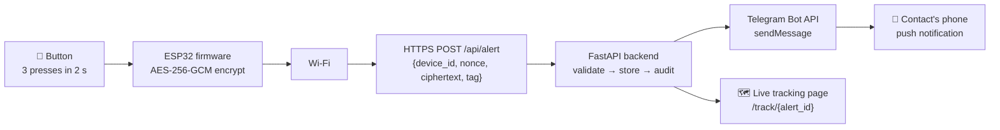
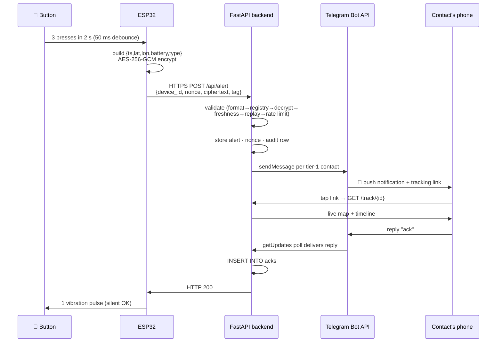

> Back to [README](../README.md) · Part of the SilentSOS docs.


# Architecture



The device never talks to Telegram directly. It only talks to the backend
over HTTPS; the backend fans out to Telegram and serves the tracking page.

## How a button press reaches a trusted contact's phone

### 1. The physical press

**Plain language:** you press a small button three times quickly — like
triple-clicking a mouse. The device ignores accidental bumps.

**Technical detail** (`firmware/silentsos/silentsos.ino`): the button is on
**GPIO 4**, wired as `INPUT_PULLUP` (the pin reads HIGH when idle; pressing
connects it to GND, reading LOW). A hardware interrupt on the FALLING edge
fires on every press, with a **50 ms debounce** — presses closer than 50 ms
are ignored as contact bounce. The firmware keeps the last three press
timestamps; if all three fall inside a **2-second window**
(`PRESS_WINDOW_MS = 2000`), it triggers an alert. A **3-second hold**
(`HOLD_MS = 3000`) instead sends a `safe` message, and a hold never also
counts as a press. After an alert, a **30-second cooldown** suppresses
duplicate alerts from shaky fingers.

### 2. Building the payload

**Plain language:** the device packs the essentials — when, where, battery,
and what happened — into a tiny JSON message.

**Technical detail:** the plaintext is compact JSON with exactly these five
fields (frozen by `docs/PROTOCOL.md` v1.0.0):

```json
{"ts": 1728859200, "lat": 27.7172, "lon": 85.3240, "battery": 87, "type": "alert"}
```

| Field | Meaning |
|---|---|
| `ts` | Unix seconds (UTC) when the event occurred |
| `lat` / `lon` | WGS84 coordinates, decimal degrees |
| `battery` | 0–100 |
| `type` | `"alert"`, `"update"`, or `"safe"` |

### 3. Encryption

**Plain language:** the message is sealed so only the server can read it —
and so nobody can tamper with it or replay an old one.

**Technical detail** (`backend/crypto.py`, `docs/PROTOCOL.md` §2.3):

- **Algorithm:** AES-256-GCM (authenticated encryption: secrecy *and*
  tamper-detection in one step).
- **Key:** a 32-byte per-device key, provisioned out-of-band and stored in
  the server registry and the device firmware. It is **never transmitted**.
- **Nonce:** 12 fresh cryptographically random bytes per request
  (`esp_random()` on the ESP32, `os.urandom()` in Python). Reusing a nonce
  with GCM would be catastrophic, so every message gets a new one.
- **AAD (additional authenticated data):** the `device_id` string as UTF-8
  bytes. This binds the ciphertext to the claimed device — an attacker can't
  take one device's message and re-label it as another's, because decryption
  with the wrong AAD fails.

### 4. Sending

**Plain language:** the device joins Wi-Fi and posts the sealed envelope to
the server over HTTPS, like a web form submission.

**Technical detail:** the HTTP body is a JSON **envelope** with four base64
fields (field names frozen):

```json
{
  "device_id": "dev-001",
  "nonce": "<base64 of 12 random bytes>",
  "ciphertext": "<base64>",
  "tag": "<base64 of the 16-byte GCM tag>"
}
```

The firmware POSTs this to `{SERVER_URL}/api/alert` using `WiFiClientSecure`
+ `HTTPClient`. HTTPS is used in production; plain HTTP is allowed only for
local development. (Demo note: the firmware ships with `setInsecure()` — no
CA validation — which is fine for a demo tunnel but must be replaced with
certificate pinning for production.)

### 5. Server validation

**Plain language:** the server distrusts everything and checks the message
six ways before believing it. Each failure gets a bare status code — no
hints for attackers.

**Technical detail** (`backend/main.py`, `docs/PROTOCOL.md` §2.4), in this
exact order:

| # | Check | Fails with |
|---|---|---|
| 0 | **Format** — body is a JSON object with exactly the four envelope fields, correct types, valid base64, nonce = 12 bytes, tag = 16 bytes | `400` |
| 1 | **Registry** — `device_id` exists and `active = 1` | `401` |
| 2 | **Decryption** — AES-256-GCM decrypt with the device key, request nonce, AAD = `device_id`; tag must verify | `401` |
| 3 | **Plaintext schema** — the five payload fields with correct types/ranges | `400` |
| 4 | **Freshness** — `|server_time − ts| ≤ 60` seconds | `408` |
| 5 | **Replay** — `(device_id, nonce)` never seen before (atomic check-then-insert) | `409` |
| 6 | **Rate limit** — at most 5 requests per 60-second sliding window per device | `429` |

All error bodies are exactly `{"status":"error"}` — the status code is the
only signal. On top of the protocol, the server also collapses a new
`alert` within 30 s of the previous one into the existing alert
(`ALERT_COOLDOWN_S = 30`).

### 6. Storing the alert

**Plain language:** the accepted alert is saved, and every request — good or
bad — is written to an audit log.

**Technical detail** (SQLite, `backend/registry.py`): an accepted `alert`
creates a row in **`alerts`** (UUID id, device, status, latest
lat/lon/battery, timestamps, JSON trail). The nonce goes into
**`used_nonces`**, the request into **`request_log`** (for the rate-limit
window), and every `/api/alert` request — accepted or rejected — into
**`audit_log`** with the check name that decided it
(`alert_created`, `update_appended`, `safe_resolved`, `replay`, …).
`update` messages append `{ts, lat, lon}` to the active alert's trail;
`safe` marks it resolved.

### 7. Notifying contacts

**Plain language:** the server texts the owner's trusted contacts through
Telegram. Each contact must have linked their Telegram account first.

**Technical detail** (`backend/telegram.py`): on `alert_created`, the
server builds the payload and calls the **Telegram Bot API `sendMessage`**
endpoint (`https://api.telegram.org/bot<token>/sendMessage`) once per
**tier-1** linked contact, using the bot token from `TELEGRAM_BOT_TOKEN` and
each contact's stored `telegram_chat_id`. The exact message is:

> 🚨 SilentSOS alert from {owner}. Live location: {tracking_link}. Battery
> {battery}%. Reply 'ack' if you're responding.

Sending happens in daemon threads and **never fails the alert** — a missing
token or a Telegram outage is logged, and the alert still succeeds. The
contact's Telegram app turns the incoming message into a push notification.

### 8. The tracking link

**Plain language:** the message contains a link. Tapping it opens a live
map that follows the device, with a big status header and a countdown.

**Technical detail:** the link is `{PUBLIC_BASE_URL}/track/{alert_id}`
(`PUBLIC_BASE_URL` env var, default `http://127.0.0.1:8001`). The page
(`backend/static/track.html`) shows an ACTIVE/ESCALATED/RESOLVED badge with
a live timer, an Esri map with the location trail, stat cards (battery, last
update, speed, signal), quick actions (Google Maps, copy location, share,
call 112), nearest-help places, an audit-driven event timeline, and the
contact list with ack states. It polls the API every few seconds, so it
updates live with no refresh.

### 9. Acknowledgement

**Plain language:** the contact replies `ack` to the bot. The server records
it, and everyone watching the tracking page sees the contact marked as
responding within seconds.

**Technical detail:** the backend **long-polls** Telegram's `getUpdates`
endpoint in a background thread (`poll_forever` in `backend/telegram.py`,
started at server startup only when a token is set) — this repo does **not**
use webhooks. When a message with text `ack` (case-insensitive) arrives from
a linked chat, the server inserts a row into **`acks`** (`INSERT OR IGNORE`,
so duplicates are harmless) for that device's latest active alert, and
replies with a confirmation. The tracking page picks up the ack on its next
poll and shows it in the contacts list and timeline.

### 10. Silent confirmation

**Plain language:** the device buzzes once — quietly — to say "alert
received". Three buzzes means something failed.

**Technical detail** (firmware): after POSTing, HTTP 200 triggers **1 short
vibration pulse** on GPIO 5 (200 ms). If all retries fail (exponential
backoff, max 3 tries, fresh nonce per try), the motor gives **3 short
pulses**. The CLI simulator prints `vibration: 1 short pulse` /
`vibration: 3 short pulses` to mirror this.

### 11. Escalation and resolution

**Plain language:** if nobody responds in time, the server alerts a second
group of contacts. When the owner is safe, one message (or a 3-second button
hold) closes the incident.

**Technical detail:** a background sweeper checks every 5 s
(`ESCALATION_POLL_S`): an active alert older than `ESCALATION_SECONDS`
(env var, default 60) with zero acks gets `escalated_at` set, an
`escalated_tier2` audit row, and the tier-2 contacts receive the ESCALATED
message. A `safe` message (3 s hold, or the tracking page's resolve button,
or `POST /api/alerts/{id}/safe`) marks the alert resolved, notifies all
contacts (`✅ {owner} has marked themselves safe.`), and schedules the
location auto-purge 24 h later.



### Latency estimates

> **Note:** these are rough estimates for planning, not measured
> guarantees. Local-network numbers assume the server runs on the same LAN.

| Stage | Typical time |
|---|---|
| Button debounce + press detection | < 0.1 s |
| Payload build + AES-256-GCM encrypt | < 0.05 s |
| Wi-Fi already connected → HTTPS POST | 0.3 – 1.5 s |
| Server validation + DB write | < 0.1 s |
| Telegram `sendMessage` → push notification | 1 – 5 s |
| Contact opens tracking link → live map | 1 – 3 s |
| `ack` reply → visible on tracking page | 2 – 8 s (polling interval) |
| Vibration confirmation after HTTP 200 | < 0.3 s |

### What can go wrong at each stage

| Stage | Failure | What happens |
|---|---|---|
| Press detection | Button bounce / single accidental press | 50 ms debounce + 3-press rule ignore it; nothing is sent |
| Encryption | Wrong key in firmware | Server decryption fails → `401`; device vibrates 3× |
| Sending | No Wi-Fi / server unreachable | Retries with backoff, then 3 vibration pulses; nothing is stored |
| Validation | Clock not synced (ESP32) | `ts` outside ±60 s → `408`; fix NTP |
| Validation | Captured packet replayed | Nonce already used → `409` |
| Validation | Too many requests | `429` after 5/min; trail updates pause until the window slides |
| Notify | Telegram down / no token | Logged only — the alert still succeeds |
| Notify | Contact never pressed Start | No `chat_id` on file; they get nothing (link them first) |
| Ack | Contact replies from an unlinked chat | Bot replies "this chat isn't linked yet" |
| Escalation | Tier-2 contact also unlinked | Skipped silently; escalation still recorded |
