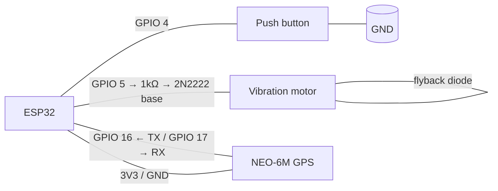

> Back to [README](../README.md) · Part of the SilentSOS docs.


# ESP32 setup

> **Note:** the firmware below is written, code-reviewed, and testable in
> the Wokwi simulator, but it has **never been compiled or run on physical
> hardware in this repo**. Treat the first build as a bring-up, not a
> victory lap.

### 1. Shopping list

| Part | Purpose | Approx. price (USD) |
|---|---|---|
| ESP32 dev board (e.g. ESP32-DevKitC) | The device itself: button, crypto, Wi-Fi | $5 – $8 |
| Push button (tactile, 6 mm) | The alert button | $0.50 |
| Vibration motor (coin type) **+ 2N2222 transistor + 1 kΩ resistor + 1N4148 flyback diode** | Silent confirmation buzz | $1 – $2 |
| NEO-6M GPS module *(optional)* | Real coordinates instead of fixed demo ones | $8 – $12 |
| LiPo battery 3.7 V + TP4056 charger board *(optional)* | Untethered operation | $5 – $8 |
| Jumper wires + breadboard | Prototyping | $3 – $5 |

Total for the core build: roughly **$13** (matches the pitch: "about
thirteen dollars in parts").

### 2. Wiring

Pin numbers come from `firmware/silentsos/silentsos.ino`:

| ESP32 pin | Connects to | Notes |
|---|---|---|
| **GPIO 4** | Push-button leg 1 | `INPUT_PULLUP`; leg 2 → GND. Active LOW. |
| **GPIO 5** | Vibration motor (+) **via 2N2222 transistor** | GPIO → 1 kΩ → transistor base; motor between 3V3 and collector; flyback diode across the motor |
| **GPIO 16** (RX2) | NEO-6M TX | Only if `USE_GPS 1` |
| **GPIO 17** (TX2) | NEO-6M RX | Only if `USE_GPS 1` |
| 3V3 | NEO-6M VCC, motor driver supply | |
| GND | Common ground | Button leg 2, GPS GND, transistor emitter |



> **Warning:** **never drive a motor directly from a GPIO pin** — a coin
> motor draws far more current than the pin can source and will damage the
> board. Always use the transistor driver shown above.
> **Warning:** check battery polarity before connecting. Reversed LiPo
> polarity can destroy the charger board and the ESP32.

### 3. Arduino IDE setup

1. Install the [Arduino IDE](https://www.arduino.cc/en/software) (2.x).
2. Add ESP32 board support: **File → Preferences → Additional boards
   manager URLs**, add
   `https://raw.githubusercontent.com/espressif/arduino-esp32/gh-pages/package_esp32_index.json`,
   then **Tools → Board → Boards Manager**, search `esp32`, install.
3. Select **Tools → Board → ESP32 Arduino → ESP32 Dev Module**.
4. Connect the board via USB. If no port appears under **Tools → Port**,
   install the USB-serial driver: **CP210x** (most DevKitCs) or **CH340**
   (clones) — check which chip is near the USB port on your board.

### 4. Install the required libraries

From `firmware/README.md` — exact names:

| Library | Needed when |
|---|---|
| **TinyGPS++** (by Mikal Hart) — via Library Manager | `USE_GPS 1` only |
| ESP32 Arduino core ≥ 2.0 | always — `WiFi`, `WiFiClientSecure`, `HTTPClient`, and mbedTLS are built in, no extra install |

### 5. Provision the device

1. Register the device on the server (or reuse `dev-001`) and export a
   paste-ready snippet:
   ```bash
   python backend/registry.py --export-config esp32-001
   ```
   > **Note:** do **not** reuse the demo key for a real device — provision
   > a fresh device row so each device has its own key.
2. Copy the template:
   ```bash
   cp firmware/silentsos/config.example.h firmware/silentsos/config.h
   ```
3. Fill in `config.h`: `WIFI_SSID`, `WIFI_PASSWORD`, `SERVER_URL` (no
   trailing slash), `DEVICE_ID`, `DEVICE_KEY_B64` (base64 of the 32-byte
   key), and set `USE_GPS` to `0` or `1`.

> **Warning:** `config.h` **must stay out of git** — it is listed in
> `.gitignore` (confirmed: `firmware/silentsos/config.h` is ignored).
> Never share the key, never paste it in a chat.

### 6. Deploy the backend publicly first

The ESP32 cannot reach `localhost`. Deploy the backend (see
[Deployment](DEPLOY.md)), then use the **public `https://` URL** as
`SERVER_URL` in `config.h`.

### 7. Flash and verify

1. **Tools → Port**: select the ESP32's port.
2. **Sketch → Upload**. Open **Tools → Serial Monitor** at **115200 baud**.
3. *Expected result* — the boot log:
   ```text
   SilentSOS firmware boot
   WiFi: connecting to YourSSID
   ...
   WiFi connected, IP: 192.168.1.42
   NTP sync via pool.ntp.org ...
   ...
   clock synced: 1792131206
   ready: 3x press = alert, 3 s hold = safe
   ```
   *If it fails:* `FATAL: DEVICE_KEY_B64 is not 32 bytes base64` — the key
   in `config.h` is wrong. `WiFi failed; rebooting` — check SSID/password
   (step 8 below).

### 8. Test checklist

- [ ] Single press → `press registered`, nothing sent.
- [ ] 3 quick presses → `triple press`, `POST … -> HTTP 200`, **1
      vibration pulse**; alert appears on `/track`.
- [ ] Telegram message arrives on the linked contact's phone.
- [ ] While the alert is active, `sending periodic update` every 15 s; the
      trail grows on the tracking page.
- [ ] 3-second hold → `3 s hold`, `safe` sent, HTTP 200; alert shows
      RESOLVED; contacts get the safe message.
- [ ] Second triple-press within 30 s → `cooldown: alert suppressed`
      (no duplicate alert).

### 9. GPS notes

- `USE_GPS 0` (default): the firmware sends the fixed demo coordinates
  (`FIXED_LAT`/`FIXED_LON` in `config.h`, default 27.7172, 85.3240 —
  Kathmandu).
- `USE_GPS 1`: reads a NEO-6M on UART2 (RX=GPIO 16, TX=GPIO 17) at 9600
  baud via TinyGPS++. Until the GPS has a valid fix (younger than 5 s),
  the firmware falls back to the fixed coordinates.
- A **first fix needs a clear sky view** and can take several minutes.
  Test outdoors or by a window; a cold start inside a concrete building
  will not fix.

### 10. Phone hotspot tip

The ESP32 supports **2.4 GHz Wi-Fi only**. If you tether from a phone,
enable the hotspot's **2.4 GHz mode** (many phones default to 5 GHz).
Captive-portal Wi-Fi (hotels, campuses — the kind that opens a login page)
**will not work**: the ESP32 can't click through the portal.

### 11. Troubleshooting

| Symptom | Cause | Fix |
|---|---|---|
| `WiFi failed; rebooting in 10 s` loop | Wrong SSID/password, 5 GHz-only network, or captive portal | Use 2.4 GHz, check credentials |
| `WARNING: NTP sync failed` / server returns `408` | No clock → `ts` rejected | Fix Wi-Fi first; NTP needs internet |
| Server returns `401` | Key mismatch, wrong `DEVICE_ID` (AAD), or bad base64 | Re-export config; `DEVICE_ID` must match the registry row exactly |
| TLS error / `HTTP -1` | Wrong `SERVER_URL`, expired tunnel, or no route to host | Check the URL; open `/api/health` in a browser first |
| Device resets / brownout | Weak USB cable or insufficient power | Use a short, thick cable or a powered hub; add a capacitor across 3V3/GND |
| Motor doesn't vibrate | Transistor wired wrong, or motor driven straight from GPIO | Re-check the driver circuit; GPIO 5 only switches the transistor |

### 12. Simulator vs real device

| Aspect | Identical | Different |
|---|---|---|
| Protocol (`/api/alert`, envelope, encryption) | ✅ byte-for-byte | |
| Server validation (all six checks) | ✅ | |
| Key storage | | Simulator: `config.json` on disk · Device: `config.h` in firmware |
| GPS | | Simulator: preset coordinates · Device: NEO-6M or fixed demo coords |
| Timing | | Simulator: manual presses · Device: 50 ms debounce, real interrupts |
| Vibration | | Simulator: printed message · Device: GPIO 5 motor |
